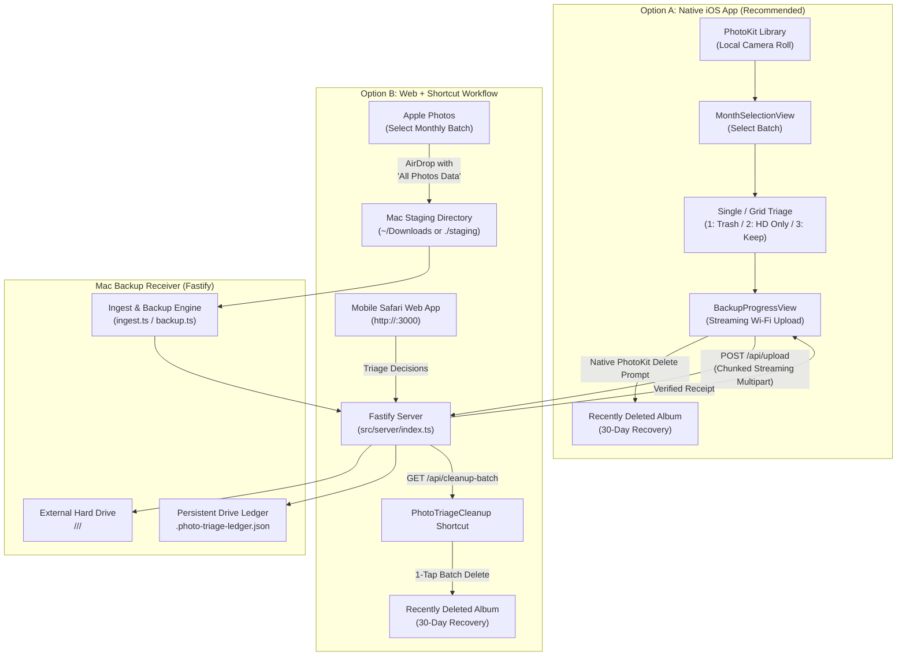

# iPhone Photo Triage & Verified Backup Solution

A complete, utilitarian local backup and cleanup system engineered to triage monthly photo batches directly on an iPhone, stream companion files over local Wi-Fi, cryptographically verify each file on an external hard drive, and safely clean up phone storage with one native tap.

---

## 1. Why This Exists

For iPhone users managing thousands of photos, backing up monthly batches to external storage is typically fraught with risk and manual friction. Every monthly batch contains **three distinct outcomes**:

1. **Trash (`trash`):** Blurry shots, accidental bursts, or duplicate screenshots — do **not** archive to the hard drive, and delete from the iPhone.
2. **Back Up Only (`backup_only`):** Long-term memories to preserve on the hard drive, then delete from the iPhone to reclaim local storage once verified.
3. **Back Up + Keep (`backup_keep`):** Long-term memories to archive on the hard drive *and* keep on the iPhone for ongoing reference.

### The Critical Problems With Traditional Approaches
- **Losing Live Photos and Edits:** Standard exports flatten or lose Apple Photos metadata, Live Photo companion videos (`.MOV`), edit sidecars (`.AAE`), and full-resolution edited renders (`IMG_E*`).
- **Accidental Deletions:** Deleting items from the phone before verifying external backup integrity can cause irreversible data loss if a drive was disconnected, full, or corrupt.
- **Shortcuts Timeouts & RAM Limits:** Running per-item database lookups across hundreds of photos in Apple Shortcuts times out or exhausts memory.

---

## 2. Two Flexible Workflows

This repository provides **two integrated ways** to triage and back up your photos:

| Feature | Option A: Native iOS App (Recommended) | Option B: Mobile Web App + iOS Shortcut |
|---|---|---|
| **Platform** | Native SwiftUI iOS 17+ App (`ios/PhotoTriage`) | Mobile Safari (`http://<lan-ip>:3000`) |
| **Source** | Direct PhotoKit access (zero AirDrop) | AirDrop to Mac staging directory |
| **Transfer** | Direct Wi-Fi streaming (`POST /api/upload`) | Local AirDrop transfer |
| **Review UI** | Utilitarian SwiftUI Single & Grid Views | Utilitarian React Single & Grid Views |
| **Verification** | Mac server verifies bytes & SHA-256 on drive | Mac server verifies bytes & SHA-256 on drive |
| **Cleanup** | Native PhotoKit 1-tap system delete prompt | 1-tap deletion via Apple Shortcuts |
| **Setup** | 3 steps in Xcode with free Apple ID | No Xcode needed, install iOS Shortcut |

---

## 3. System Architecture



---

## 4. Key Features

- **Direct PhotoKit Integration:** Directly queries local photo batches by month, grouping primary photos (`.HEIC`/`.JPG`), companion videos (`.MOV`), and edit sidecars (`.AAE`) into unified bundles.
- **Utilitarian, High-Density Interface:** Zero decorative fluff. High-contrast tactile action buttons, monospaced metadata, and instant keyboard shortcuts (`1`, `2`, `3`, `Z`) or mobile touch controls.
- **Dual Review Modes:** Switch effortlessly between **1-by-1 Single View** (with full-bleed media previews and badge indicators) and **Grid View** (with multi-select batch assignment and filter pills).
- **Streaming Wi-Fi Upload:** Streams large files chunk-by-chunk to the Mac over local Wi-Fi with constant memory usage on iOS.
- **Automatic `YYYY/MONTH` Organization:** Automatically saves assets into uppercase folder hierarchies (e.g. `/Volumes/MyPassport/2024/JULY/`) based on EXIF or QuickTime metadata.
- **Cryptographic Byte & SHA-256 Verification:** Cleanup remains strictly locked until every companion file is confirmed on the external hard drive with matching byte size and SHA-256 hash.
- **Collision-Safe Renaming & Deduplication:** If a file with the same name exists on the hard drive with different contents, it is safely suffixed (e.g. `IMG_2048_2.HEIC`). If the SHA-256 hash matches, it deduplicates without redundant writes.
- **Forward-Looking Backup Ledger:** Maintains `.photo-triage-ledger.json` on the external hard drive to track previously backed-up assets across sessions.
- **1-Tap Safe Deletion:** Confirmed delete candidates are sent to Apple Photos' **Recently Deleted** album via native system confirmation, preserving a 30-day recovery window.

---

## 5. Prerequisites

- **Mac Computer:** macOS Sonoma (14.0) or higher with Node.js v20+ and Xcode 15/16 installed.
- **iPhone:** iOS 17.0 or higher.
- **External Hard Drive:** Formatted as APFS, Mac OS Extended (Journaled), or ExFAT, mounted under `/Volumes/`.
- **Local Wi-Fi:** iPhone and Mac connected to the same local Wi-Fi network.

---

## 6. Quick Start: Native iOS App (Recommended)

Follow the complete step-by-step guide in [docs/ios-setup-guide.md](docs/ios-setup-guide.md).

### 1. Install & Run on iPhone
1. Connect your iPhone to your Mac via cable.
2. Open the Xcode project:
   ```bash
   open ios/PhotoTriage.xcodeproj
   ```
3. Select your **Personal Team** under **Signing & Capabilities** (free 7-day personal certificate, no paid account required).
4. Select your iPhone in the top toolbar and press **Play (`Cmd + R`)**.
5. On your iPhone, trust your certificate in **Settings > General > VPN & Device Management**.

### 2. Start the Mac Server
In your terminal, start the Mac backup receiver:
```bash
npm install
npm start -- --drive /Volumes/YourHardDrive
```

### 3. Triage & Back Up
1. Open **PhotoTriage** on your iPhone.
2. In **Settings**, tap **"Ping Server"** to confirm connection.
3. Select a month and triage with **Trash (1)**, **HD Only (2)**, or **Keep (3)**.
4. Tap **Backup & Cleanup** -> **Start Backup & Cleanup**.
5. The Mac streams and cryptographically verifies files on your hard drive, then prompts for 1-tap native deletion.

---

## 7. Quick Start: Web App & iOS Shortcut Mode

If you prefer using Mobile Safari and AirDrop instead of Xcode:

1. Follow [docs/shortcut-guide.md](docs/shortcut-guide.md) to set up the `PhotoTriageCleanup` shortcut.
2. AirDrop your monthly photos with **"All Photos Data" ON** to your Mac.
3. Start the server with `npm start`.
4. Scan the terminal QR code with your iPhone camera to open `http://<lan-ip>:3000`.
5. Triage, execute backup, and tap **"Run iOS Shortcut (1-Tap Cleanup)"**.

---

## 8. REST API Reference

| Endpoint | Method | Description |
|---|---|---|
| `POST /api/upload` | `POST` | Streaming multipart upload endpoint receiving asset bundles (`primary`, `live_video`, `edit_sidecar`) from the native iOS app. Verifies SHA-256 and updates ledger. |
| `GET /api/session` | `GET` | Returns current batch, triage counts, hard drive mount status, and session state. |
| `POST /api/session` | `POST` | Update session parameters (`stagingDir`, `hardDriveRoot`). |
| `POST /api/triage` | `POST` | Assign triage decision for single `bundleId` or array of `bundleIds`. |
| `POST /api/backup` | `POST` | Executes backup and byte/hash verification for triaged assets in staging. |
| `GET /api/cleanup-batch` | `GET` | Returns date bounds and pipe-delimited delete payload for iOS Shortcut. Locked until backup is verified. |
| `POST /api/cleanup-complete` | `POST` | Called by iOS Shortcut upon completing Camera Roll deletion. |
| `GET /media/*` | `GET` | Static media streaming endpoint serving image/video previews. |

---

## 9. Development & Testing

Run all unit, contract, and E2E integration tests:
```bash
npm test
```

Run tests in watch mode:
```bash
npm run test:watch
```

Run TypeScript build:
```bash
npm run build
```

Run the E2E iOS upload integration test suite:
```bash
npx vitest run tests/e2e/ios-upload.test.ts
```

Validate Swift 6 type safety:
```bash
swiftc -typecheck -swift-version 6 ios/PhotoTriage/Models/*.swift ios/PhotoTriage/Services/*.swift ios/PhotoTriage/Views/*.swift
```

---

## 10. Safety Guarantees

1. **Zero Premature Deletions:** Deletion commands (both native PhotoKit and iOS Shortcut) are strictly disabled until 100% of backed-up files match byte counts and SHA-256 hashes on the physical hard drive.
2. **`backup_keep` Immunization:** Assets marked `backup_keep` are excluded from all deletion operations.
3. **Collision Preservation:** Incoming files sharing a filename with an existing hard drive file of different content are safely suffixed (e.g. `IMG_1001_2.HEIC`). Existing files are never overwritten.
4. **Non-Destructive Trashing:** All deletions move items to Apple Photos' **Recently Deleted** album, preserving a 30-day recovery safety net.
