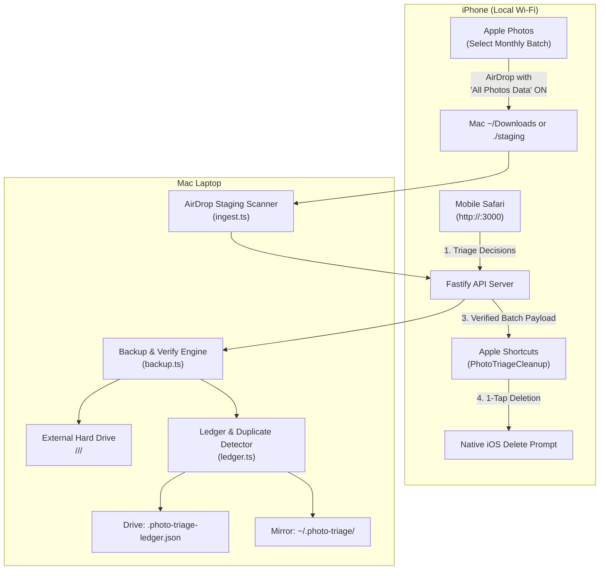

# iPhone Photo Triage & Verified Backup Solution

A high-performance, utilitarian local web system and companion iOS Shortcut designed to triage monthly photo batches (hundreds of items) directly on an iPhone, organize and cryptographically verify all companion files on an external hard drive, and safely clean up phone storage with one native tap.

---

## 1. Why This Exists

For iPhone users with Lightning ports backing up monthly photo batches to external storage, managing photos across phone, laptop, and hard drive is typically fraught with risk and manual friction. Every monthly batch contains **three distinct outcomes**:

1. **Trash (`trash`):** Blurry shots, accidental bursts, or duplicate screenshots — do **not** archive to the hard drive, and delete from the iPhone.
2. **Back Up Only (`backup_only`):** Long-term memories to preserve on the hard drive, then delete from the iPhone to free up valuable local storage once confirmed.
3. **Back Up + Keep (`backup_keep`):** Long-term memories to archive on the hard drive *and* keep on the iPhone for quick reference.

### The Critical Problem With Traditional Approaches
- **Losing Live Photos and Edits:** Standard exports flatten or lose Apple Photos metadata, Live Photo companion videos (`.MOV`), edit sidecars (`.AAE`), and full-resolution edited renders (`IMG_E*`).
- **Accidental Deletions:** Deleting items from the phone before verifying external backup integrity can cause irreversible data loss if a drive was disconnected, full, or corrupt.
- **Shortcuts Timeouts:** Running per-item database lookups across hundreds of photos in Apple Shortcuts app crashes or times out.

---

## 2. Key Features

- **Utilitarian, High-Density Interface:** Zero decorative fluff. High-contrast, tactile controls, monospaced metadata, and instant keyboard shortcuts (`1`, `2`, `3`, `Z`) or mobile swipe controls.
- **Dual Review Modes:** Switch effortlessly between **1-by-1 Single View** (with full-bleed media previews and badge indicators) and **Grid View** (with multi-select batch assignment and filter tabs).
- **"All Photos Data" Companion Grouping:** Automatically groups primary photos (`IMG_1001.HEIC`), Live Photo companion videos (`IMG_1001.MOV`), edit instructions (`IMG_1001.AAE`), and rendered edits (`IMG_E1001.HEIC`) into a single logical asset.
- **Automatic `YYYY/MONTH` Structure:** Organizes assets into uppercase folder hierarchies (e.g. `/Volumes/MyPassport/2024/MAY/`) based on EXIF `DateTimeOriginal` or QuickTime metadata.
- **Cryptographic Byte & SHA-256 Verification:** Phone cleanup remains strictly locked until every companion file of every backed-up asset is confirmed on the external drive with matching byte size and SHA-256 hash.
- **Forward-Looking Backup Ledger:** Maintains `.photo-triage-ledger.json` on the external drive (mirrored locally on the Mac in `~/.photo-triage/`) to prevent duplicate backups of `backup_keep` photos in future sessions.
- **Collision-Safe Renaming:** If a file with the same name exists on the hard drive with a *different* hash, the entire bundle is safely saved with a unique suffix (e.g. `IMG_1001_2.HEIC`).
- **1-Tap iOS Shortcut Cleanup:** Queries Apple Photos with a single date-bounded search and in-memory name token filter to present a single native iOS system delete prompt for the entire batch.
- **Instant Camera Pairing:** Displays an ASCII QR code directly in your terminal at server launch for one-scan iPhone pairing over your local Wi-Fi.

---

## 3. System Architecture



---

## 4. Prerequisites

- **Node.js:** v20.0.0 or higher
- **macOS:** with `mdls` available for QuickTime metadata inspection
- **External Hard Drive:** Formatted as APFS, Mac OS Extended (Journaled), or ExFAT, mounted under `/Volumes/`
- **Wi-Fi:** iPhone and Mac connected to the same local Wi-Fi network

---

## 5. Installation & Setup

1. **Clone the repository:**
   ```bash
   git clone https://github.com/derk/photos-solution.git
   cd photos-solution
   ```

2. **Install dependencies:**
   ```bash
   npm install
   ```

3. **Build the client application:**
   ```bash
   npm run build
   ```

4. **Set up the iOS Shortcut:**
   Follow the step-by-step instructions in [docs/shortcut-guide.md](file:///Users/derk/Documents/github-repositories/photos-solution/docs/shortcut-guide.md) to install the `PhotoTriageCleanup` shortcut on your iPhone.

---

## 6. End-to-End Workflow

### Step 1: AirDrop Photos with "All Photos Data"
1. On your iPhone, open **Photos**, tap **Select**, and select the photos for your monthly batch.
2. Tap the **Share** button (box with upward arrow).
3. Tap **Options** at the top of the share sheet.
4. Toggle **"All Photos Data"** to **ON**, then tap **Done**.
5. Tap **AirDrop** and select your Mac.
   - Files land in `~/Downloads/` (or your configured staging directory) preserving original `.HEIC`, `.MOV`, `.AAE`, and `.JPG` files.

### Step 2: Start the Local Server
Run the triage server:
```bash
npm start
```
*Optional CLI flags:*
- `--staging <path>`: Custom staging folder (defaults to auto-detecting `~/Downloads/AirDrop*` or `./staging`).
- `--drive <path>`: External hard drive root (defaults to `/Volumes`).
- `--port <number>`: Port number (defaults to `3000` or `PORT` env var).

Example with specific hard drive:
```bash
npm start -- --staging ~/Downloads/AirDrop --drive /Volumes/MyPassport
```

The terminal will display a camera-scannable QR code:
```text
==========================================================
  iPhone Photo Triage & Verified External Backup Server
==========================================================
[QR Code Here]

  Local URL:    http://localhost:3000
  Network URL:  http://192.168.1.50:3000
  Staging:      /Users/username/Downloads/AirDrop
  Hard Drive:   /Volumes/MyPassport
```

### Step 3: Triage on Your iPhone
1. Open your iPhone camera and scan the QR code to open the web app.
2. Sort each item into one of three buckets:
   - **`🗑️ Trash`** (Key: `1` or tap Trash)
   - **`💾 Only`** (Key: `2` or tap Back Up Only)
   - **`💾 + 📱 Keep`** (Key: `3` or tap Back Up + Keep)
3. Use the **Grid View** tab for bulk selection and multi-item triage.
4. Tap **Undo** (Key: `Z`) anytime to revert your last decision.

### Step 4: Execute Verified Backup
1. Switch to the **Desktop** tab or tap **Execute Backup**.
2. The server copies all companion files to `<HardDriveRoot>/<YYYY>/<MONTH>/`.
3. The server computes and compares exact byte counts and SHA-256 hashes against staging sources.
4. Trash files are purged from staging; verified bundles are recorded in the ledger.
5. The **Cleanup Screen** unlocks.

### Step 5: 1-Tap Cleanup on iPhone
1. In the web app, tap the **Cleanup** tab.
2. Tap **"Run iOS Shortcut (1-Tap Cleanup)"**.
3. iOS opens the `PhotoTriageCleanup` shortcut.
4. Tap **Delete** on the native Apple Photos system confirmation prompt.
5. The shortcut notifies the server and your session is marked complete!

---

## 7. REST API Reference

| Endpoint | Method | Description |
|---|---|---|
| `/api/session` | `GET` | Returns current batch, triage counts, hard drive mount status, and session state. |
| `/api/session` | `POST` | Update session parameters (stagingDir, hardDriveRoot). |
| `/api/triage` | `POST` | Assign triage decision for single `bundleId` or array `bundleIds`. |
| `/api/backup` | `POST` | Executes backup and byte/hash verification for triaged assets. |
| `/api/cleanup-batch` | `GET` | Returns date bounds and pipe-delimited delete payload for iOS Shortcut. Locked until backup is verified. |
| `/api/cleanup-complete` | `POST` | Called by iOS Shortcut upon completing Camera Roll deletion. |
| `/media/*` | `GET` | Static media streaming endpoint serving image/video previews. |

---

## 8. Development & Testing

Run unit, integration, and E2E tests:
```bash
npm test
```

Run test suite in watch mode:
```bash
npm run test:watch
```

Run production build:
```bash
npm run build
```

---

## 9. Safety Guarantees

1. **Zero Premature Deletions:** `/api/cleanup-batch` returns HTTP 400 until 100% of backed up files match SHA-256 checksums on the hard drive.
2. **`backup_keep` Immunization:** Assets marked `backup_keep` are stripped from all deletion payloads.
3. **Collision Safety:** Any delete candidate sharing a canonical name with a kept photo, or lacking reliable EXIF date metadata, is excluded from automatic deletion and routed to manual review.
4. **Non-Destructive Trashing:** Even when deleted from the iPhone via Apple Shortcuts, photos remain in Apple Photos' **Recently Deleted** album for 30 days.
