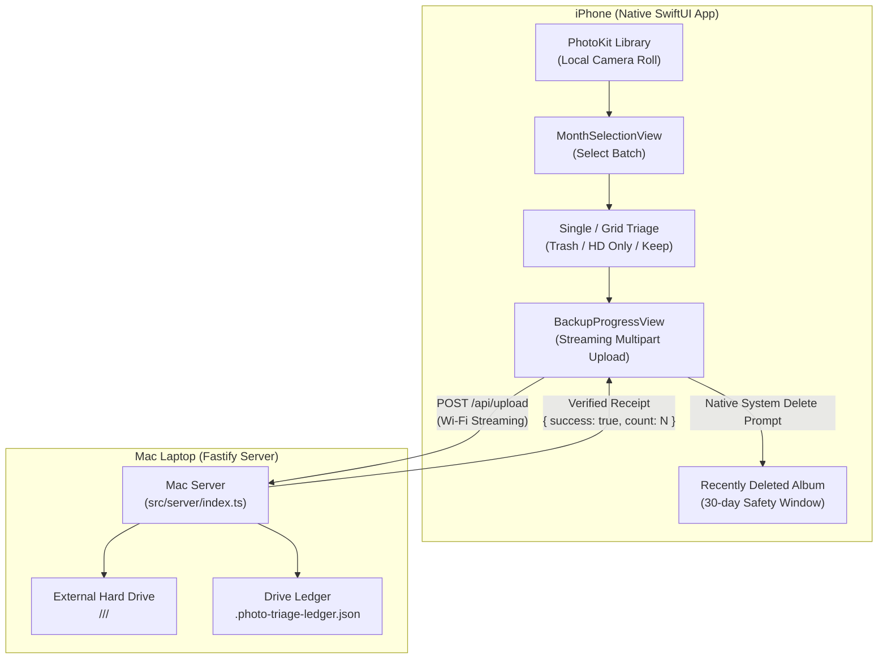

# Native iOS App Setup & User Guide

This guide provides end-to-end instructions for building, installing, and running the native **PhotoTriage** iOS app directly on your physical iPhone using Xcode and a free Apple ID (no paid Apple Developer program membership required).

---

## 1. Overview & Architecture

The **PhotoTriage** native iOS app works in concert with the **Mac Backup Receiver** to provide a fast, utilitarian, and cryptographically verified photo archival workflow directly from your iPhone.



### Key Capabilities
- **Direct PhotoKit Access:** Reads your actual photo library without requiring AirDrop or manual file exports.
- **Companion Preservation:** Automatically extracts and bundles primary images (`.HEIC`/`.JPG`), Live Photo companion videos (`.MOV`), edit instructions (`.AAE`), and rendered edits (`IMG_E*`).
- **Streaming Wi-Fi Upload:** Streams files chunk-by-chunk to your Mac over local Wi-Fi without holding large video files in iPhone RAM.
- **Cryptographic Verification Before Deletion:** Assets are only eligible for deletion after the Mac verifies byte counts and SHA-256 hashes on the physical external hard drive.
- **Native 1-Tap Deletion:** Uses standard iOS PhotoKit batch deletion to present a single system confirmation dialog for the entire month.

---

## 2. Prerequisites

Before getting started, make sure you have:

1. **Mac Computer:** Running macOS Sonoma (14.0) or later with **Xcode 15 or 16** installed (download free from Mac App Store).
2. **iPhone:** Running **iOS 17.0** or later (tested on iPhone 12 through iPhone 16 Pro).
3. **Connection Cable:** Lightning-to-USB or USB-C cable to connect your iPhone to your Mac for the initial installation.
4. **Apple ID:** Any standard, free Apple ID (used for free personal development signing).
5. **Local Wi-Fi:** Both your iPhone and Mac connected to the same Wi-Fi network.
6. **External Hard Drive:** Formatted as APFS, Mac OS Extended (Journaled), or ExFAT, mounted on your Mac.

---

## 3. Step 1: Connect iPhone & Open Xcode Project

1. Connect your iPhone to your Mac with your USB/Lightning cable.
2. Unlock your iPhone. If prompted with **"Trust This Computer?"**, tap **Trust** and enter your iPhone passcode.
3. On your Mac, open Terminal, navigate to the repository, and open the Xcode project:
   ```bash
   cd photos-solution
   open ios/PhotoTriage.xcodeproj
   ```

---

## 4. Step 2: Configure Free Personal Team Signing

You do **not** need a paid \$99/year Apple Developer account. Apple permits free personal app signing valid for 7 days at a time.

1. In Xcode's left sidebar (Project Navigator), click on the top-level blue project icon: **PhotoTriage**.
2. In the main editor pane, select the **PhotoTriage** target under **Targets**.
3. Click the **Signing & Capabilities** tab at the top.
4. Ensure **Automatically manage signing** is checked.
5. In the **Team** dropdown:
   - If your personal Apple ID is already listed (e.g. `Jane Doe (Personal Team)`), select it.
   - If no team is shown, select **Add an Account...**, enter your free Apple ID credentials, and once added, choose your **Personal Team**.
6. If Xcode displays a warning about Bundle Identifier uniqueness, you can customize the Bundle Identifier to make it globally unique (e.g., `com.yourname.PhotoTriage`).

> [!NOTE]
> Xcode will automatically generate a free personal provisioning profile. Free personal provisioning profiles remain valid on your device for 7 days. If the profile expires, simply reconnect the cable and click "Play" in Xcode again.

---

## 5. Step 3: Build & Run on Your iPhone

1. In Xcode's top toolbar, locate the run destination selector (next to the **Play / Stop** buttons).
2. Click the destination selector and choose your physical iPhone from the list (e.g. **Your iPhone**), rather than a simulator.
3. Click the **Play** button (or press `Cmd + R`) to compile and install the app.
4. Xcode will compile the Swift source files, sign the binary, and install **PhotoTriage** onto your iPhone.

### Enabling Developer Mode (iOS 16 & iOS 17+)
If Xcode displays an alert stating **"Developer Mode is disabled"**:
1. On your iPhone, open **Settings > Privacy & Security**.
2. Scroll to the bottom and tap **Developer Mode**.
3. Toggle Developer Mode **ON**.
4. Tap the prompt to restart your iPhone.
5. After rebooting and unlocking your phone, tap **Turn On** on the system alert and enter your passcode.
6. Return to Xcode and press `Cmd + R` again.

---

## 6. Step 4: Trust the Developer Certificate on iOS

The first time you install an app using a personal Apple ID, iOS blocks opening it until you trust your certificate:

1. On your iPhone, open **Settings > General > VPN & Device Management**.
2. Under the **Developer App** section, tap your Apple ID email.
3. Tap **Trust "[Your Apple ID]"**.
4. In the pop-up confirmation, tap **Trust**.
5. Return to your home screen and tap the **PhotoTriage** icon to open the app.
6. When prompted for **Photo Library Access**, tap **"Allow Full Access"** so the app can scan monthly batches, extract full companion files, and execute verified deletions.

---

## 7. Step 5: Start Mac Server & Verify Connection

1. On your Mac, ensure your external hard drive is plugged in and mounted.
2. In your terminal, start the Mac server:
   ```bash
   npm start
   ```
   *(To specify a custom hard drive mount: `npm start -- --drive /Volumes/MyPassport`)*

3. The server prints its LAN network address in the startup banner:
   ```text
   ==========================================================
     iPhone Photo Triage & Verified External Backup Server
   ==========================================================
     Local URL:    http://localhost:3000
     Network URL:  http://10.142.1.127:3000
     Staging:      ./staging
     Hard Drive:   /Volumes/MyPassport
   ==========================================================
   ```

4. In the **PhotoTriage** app on your iPhone:
   - Tap the **Settings (gear)** icon in the navigation bar.
   - Verify the **Server URL** matches your Mac's LAN address (e.g. `http://10.142.1.127:3000`).
   - Tap **"Ping Server"**.
   - You should see a green checkmark: **"Server is reachable (Hard drive mounted)"**.

---

## 8. Step 6: Monthly Photo Triage & Verified Backup Workflow

Now you can triage and backup your monthly photo batches with total confidence.

```
Month Selection  ──>  Single / Grid Triage  ──>  Backup & Cleanup  ──>  Native Delete
(Pick YYYY/MM)       (Assign 1, 2, or 3)       (Stream to Mac)       (Free Up Storage)
```

### 1. Select a Month
- From the home screen, select any month card (e.g. **"JUL 2024 — 142 items"**).
- The app instantly loads and groups all primary photos, Live Photo videos, and AAE sidecars.

### 2. Triage Your Photos
- **Single View:** View each photo/video full-screen with high-contrast tactile action buttons:
  - **`🗑️ Trash`** (Key 1 / Red): Unwanted photos, blurry shots, duplicate screenshots. Marked for deletion from iPhone without backing up.
  - **`💾 HD Only`** (Key 2 / Orange): Memorable photos you want preserved on external hard drive, then removed from iPhone to free up phone storage.
  - **`💾 + 📱 Keep`** (Key 3 / Green): Favorites you want archived to the external hard drive *and* kept on your phone.
  - **`↩️ Undo`** (Key Z / Gray): Instantly reverts your previous triage action.
- **Grid View:** Tap the Grid tab to review thumbnails in a high-density matrix. Select multiple photos to assign decisions in bulk.

### 3. Start Backup & Cleanup
- When all or desired photos are triaged, tap **"Backup & Cleanup"** in the top-right corner.
- Review the summary counts:
  - Back Up & Delete from iPhone (`backup_only`)
  - Back Up & Keep on iPhone (`backup_keep`)
  - Delete from iPhone Only (`trash`)
- Tap **"Start Backup & Cleanup"**.

### 4. What Happens During Backup
1. **Streaming Upload:** The app streams each photo and its companion files (`.MOV`, `.AAE`) to `POST /api/upload` on your Mac.
2. **Drive Storage:** The Mac writes the bundle into `<HardDriveRoot>/<YYYY>/<MONTH>/` (e.g. `/Volumes/MyPassport/2024/JULY/IMG_2048.HEIC`).
3. **Collision Safety:** If a file with that name already exists on your hard drive with different contents, the Mac automatically suffixes the incoming file (e.g. `IMG_2048_2.HEIC`). If the SHA-256 hash matches an existing file, it deduplicates without redundant writes.
4. **Cryptographic Verification:** The Mac verifies exact byte counts and SHA-256 hashes against the uploaded data.
5. **Ledger Commit:** The Mac records the verified asset in `.photo-triage-ledger.json`.
6. **Native System Delete:** The iPhone receives the verified receipt and presents Apple's native confirmation dialog:
   > *"Allow 'PhotoTriage' to delete X items?"*
7. Tap **Delete**. The photos are removed from your active Camera Roll and placed in **Recently Deleted** (where they remain recoverable for 30 days).

---

## 9. Troubleshooting & FAQ

### "Server Unreachable" error when tapping Ping Server
- **Same Wi-Fi Network:** Ensure your iPhone is not on cellular data or a guest Wi-Fi network with client isolation. Both Mac and iPhone must be on the same local subnet.
- **Local Network Permission:** Ensure iOS has granted PhotoTriage permission to access the local network (**iPhone Settings > PhotoTriage > Local Network** toggle ON).
- **Mac Firewall:** If the macOS Application Firewall is active, allow incoming connections for Node / tsx in **System Settings > Network > Firewall**.

### "The certificate for this app is invalid or has expired"
Free personal provisioning profiles last **7 days**. When the 7 days expire:
1. Re-connect your iPhone to your Mac via cable.
2. Open `PhotoTriage.xcodeproj` in Xcode.
3. Click the **Play** button (`Cmd + R`).
4. Xcode refreshes the free certificate for another 7 days. Your app settings and triaged data are preserved.

### Are Live Photos preserved in full motion?
**Yes.** PhotoKit extracts both the primary image asset (`.HEIC` or `.JPG`) and the companion video (`.MOV`). Both files are streamed together as a single logical bundle to the Mac server and stored side-by-side on your external hard drive with matching base names.

### What if I accidentally trash a photo?
Apple Photos places deleted items in your **Recently Deleted** album. You have a **30-day grace period** to recover any deleted photo directly from the Photos app.

---

## 10. Summary Command Quick Reference

| Action | Command / Location |
|---|---|
| Open iOS Project in Xcode | `open ios/PhotoTriage.xcodeproj` |
| Build & Run on iPhone | Press `Cmd + R` in Xcode |
| Start Mac Server | `npm start` |
| Start Mac Server with Custom Drive | `npm start -- --drive /Volumes/<DriveName>` |
| Run Full Test Suite | `npm test` |
| Trust Developer Profile | iPhone Settings > General > VPN & Device Management |
| Developer Mode Toggle | iPhone Settings > Privacy & Security > Developer Mode |
