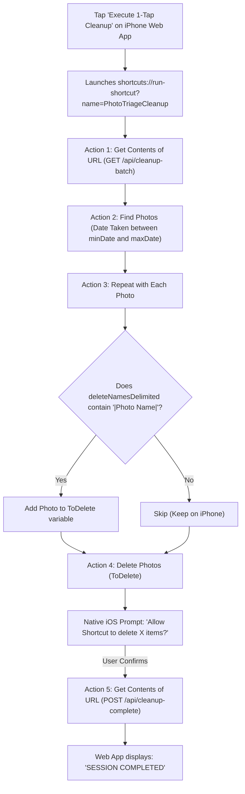

# PhotoTriageCleanup iOS Shortcut Guide

This guide walks through creating and configuring the **`PhotoTriageCleanup`** iOS Shortcut in Apple's built-in **Shortcuts** app on your iPhone.

Once set up, tapping **"Execute 1-Tap Cleanup via iOS Shortcut"** in the mobile web app automatically launches this shortcut, selects all verified delete candidates, prompts you with a single native iOS system confirmation dialog, and marks your triage session complete on your Mac.

---

## 1. Overview & Architecture

### Why This Design?
- **Zero Database Loops:** Traditional shortcuts that search Apple Photos in a loop of hundreds of items time out and fail. This shortcut runs **one single** date-bounded `Find Photos` query (`Date Taken is between minDate and maxDate`) and filters the results in memory.
- **Fail-Safe Protection for Kept Photos:** Photos designated as `Back Up + Keep` are strictly excluded on the Mac before the payload is sent. Furthermore, any collision risks (e.g. photos without reliable EXIF dates) are separated into a manual review list.
- **Single Confirmation Dialog:** Deletes hundreds of photos with one single Apple Photos permission prompt.

### Workflow Diagram



---

## 2. Step-by-Step Shortcut Creation

Open the **Shortcuts** app on your iPhone, tap **+** in the top right to create a new shortcut, and name it **`PhotoTriageCleanup`** (exact name is required for URL scheme integration).

### Action 1: Receive Dynamic Cleanup URL & Fetch Batch

1. Add a **URL** or **Text** action to resolve the cleanup endpoint:
   - **Dynamic (Recommended):** The web app passes the cleanup URL dynamically via `Shortcut Input` (`shortcuts://run-shortcut?name=PhotoTriageCleanup&input=text&text=...`). Select **`Shortcut Input`** as the URL.
   - **Fallback (Standalone / Testing):** If running manually without `Shortcut Input`, fall back to your static Mac LAN IP:
     ```text
     http://<YOUR_MAC_LAN_IP>:3000/api/cleanup-batch
     ```
     *(The server prints this IP address and scannable QR code on launch).*
   - Name the output variable **`CleanupURL`**.
2. Add the **Get Contents of URL** action:
   - **URL:** `CleanupURL`
   - **Method:** `GET`
   - **Headers:** `Accept: application/json`
3. Tap the output variable name and name it **`BatchPayload`**.

---

### Action 2: Parse Date Range & Find Photos in Camera Roll

1. Add **Get Dictionary Value** action:
   - **Key:** `minDate`
   - **Dictionary:** `BatchPayload`
   - Set output variable to **`MinDate`**.
2. Add **Get Dictionary Value** action:
   - **Key:** `maxDate`
   - **Dictionary:** `BatchPayload`
   - Set output variable to **`MaxDate`**.
3. Add **Get Dictionary Value** action:
   - **Key:** `deleteNamesDelimited`
   - **Dictionary:** `BatchPayload`
   - Set output variable to **`DelimitedNames`**.
4. Add **Find Photos** action:
   - Filter: `Date Taken` is between `MinDate` and `MaxDate`
   - **Limit:** Off (allow retrieving all photos within the date range)
   - Set output variable to **`CandidatePhotos`**.

---

### Action 3: Filter Delete Candidates In-Memory

1. Add **Repeat with Each** action:
   - Input: **`CandidatePhotos`**
2. Inside the repeat block, add a **Text** action:
   - Content: `|[Repeat Item's Name]|` (e.g. `|` followed by `Repeat Item` -> tap it -> choose `Name`, followed by `|`).
3. Add an **If** action:
   - Condition: If **`DelimitedNames`** **contains** `Text`
4. Inside the **If** block, add **Add to Variable**:
   - Variable: **`ToDelete`**
   - Value: `Repeat Item`
5. Close the **End If** and **End Repeat** blocks.

---

### Action 4: Native Single-Prompt Deletion

1. Add the **Delete Photos** action:
   - Input: **`ToDelete`**
   - Confirm Deletion: `True` (iOS will show a single system confirmation dialog listing the total count of photos to delete).

---

### Action 5: Notify Server of Completion

1. Add **URL** action:
   ```text
   http://<YOUR_MAC_LAN_IP>:3000/api/cleanup-complete
   ```
2. Add **Get Contents of URL** action:
   - **Method:** `POST`
   - **Headers:** `Content-Type: application/json`
3. Add a **Show Notification** or **Vibrate Device** action (optional):
   - Message: `Triage cleanup completed successfully!`

---

## 3. Summary of Exact Shortcut Configuration

| # | Action Name | Parameters / Values | Output Variable |
|---|-------------|---------------------|-----------------|
| 1 | **URL / Shortcut Input** | **Dynamic Input (Primary):** `Shortcut Input`<br>*(Passed dynamically by Web App via `&input=text&text=...`)*<br>**Static Fallback:** `http://<MAC_IP>:3000/api/cleanup-batch` | `CleanupURL` |
| 2 | **Get Contents of URL** | Method: `GET`, URL: `CleanupURL`, Headers: `Accept: application/json` | `BatchPayload` |
| 3 | **Get Dictionary Value** | Key: `minDate`, Dict: `BatchPayload` | `MinDate` |
| 4 | **Get Dictionary Value** | Key: `maxDate`, Dict: `BatchPayload` | `MaxDate` |
| 5 | **Get Dictionary Value** | Key: `deleteNamesDelimited`, Dict: `BatchPayload` | `DelimitedNames` |
| 6 | **Find Photos** | `Date Taken` between `MinDate` and `MaxDate` | `CandidatePhotos` |
| 7 | **Repeat with Each** | In: `CandidatePhotos` | `Repeat Item` |
| 8 | **Text** | `|[Repeat Item's Name]|` | `Token` |
| 9 | **If** | `DelimitedNames` contains `Token` | — |
| 10 | **Add to Variable** | Add `Repeat Item` to `ToDelete` | `ToDelete` |
| 11 | **End If** | — | — |
| 12 | **End Repeat** | — | — |
| 13 | **Delete Photos** | Photos: `ToDelete` | Native iOS Prompt |
| 14 | **URL** | `http://<MAC_IP>:3000/api/cleanup-complete` | `CompleteURL` |
| 15 | **Get Contents of URL** | Method: `POST`, URL: `CompleteURL` | — |

> [!NOTE]
> **Dynamic URL Passing via Shortcut Input:**
> When you tap **"Run iOS Cleanup Shortcut"** in the web app, it invokes `shortcuts://run-shortcut?name=PhotoTriageCleanup&input=text&text=${encodeURIComponent(cleanupUrl)}`. This dynamically supplies the Mac's LAN IP and port at runtime via `Shortcut Input`, so you never need to edit or reconfigure IP addresses in iOS Shortcuts when switching Wi-Fi networks! The static Mac IP is only needed as a manual testing fallback.

---

## 4. Privacy & Permissions on iOS

When you run the shortcut for the first time, iOS will ask for permissions:
1. **Allow "PhotoTriageCleanup" to access your Photos library?** -> Tap **Always Allow**.
2. **Allow "PhotoTriageCleanup" to connect to local network?** -> Tap **Always Allow**.
3. **Allow "PhotoTriageCleanup" to delete X photos?** -> Tap **Delete**.
*(Deleted photos are placed in Apple Photos' **Recently Deleted** album for 30 days, providing an extra safety cushion).*

---

## 5. Web App Integration

In the mobile web app on your iPhone (`http://<MAC_LAN_IP>:3000`):
1. Complete triage decisions in **1-by-1** or **Grid** view.
2. Tap **Run Backup & Verify** on the Desktop or Mobile status screen.
3. Once 100% of files pass byte and SHA-256 verification, navigate to the **Cleanup** tab.
4. Tap **Run iOS Shortcut (1-Tap Cleanup)**.
5. iOS automatically launches Shortcuts and runs `PhotoTriageCleanup`.
6. Confirm the native delete prompt.
7. Return to Safari — the web app will display:
   ```text
   STATUS: CLEANUP COMPLETED
   All unwanted and backed-up photos have been safely cleared from your phone.
   ```
